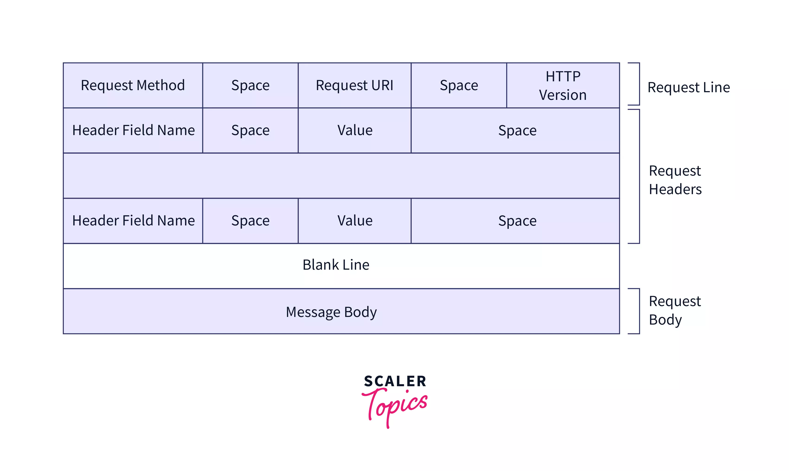
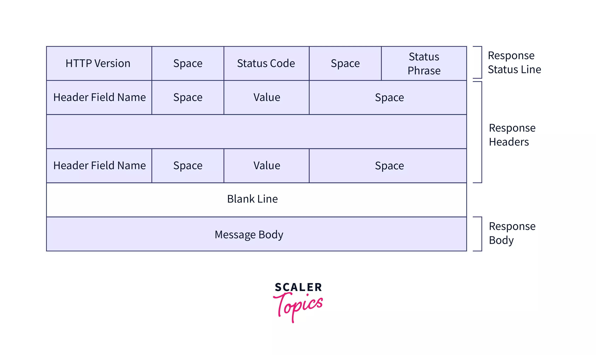

# Socat Demo

I wanted to make a video on the basis of all networking on linux. Sockets.

They are used everywhere in each of the protocols that we use and central to how everything connects with each other.

We are going to learn how HTTP works using `Socat`

`Socat` stands for SOcket CAT

- HTTP Request structure

    

- HTTP Response structure

    


what is socat and how does it work

```bash
socat -d -d STDIN STDOUT
```

Start a normal server and write to a file

```bash
socat TCP-LISTEN:3000,reuseaddr,fork CREATE:text-requests.txt
```

```bash
socat TCP-LISTEN:3000,reuseaddr,fork STDOUT
```

Start a normal server and return a response

```bash
cat <<EOF > response.http
HTTP/1.1 200 OK
Content-Type: text/plain
Content-Length: 3
Connection: close

ok
EOF

socat -v TCP-LISTEN:3333,reuseaddr,fork SYSTEM:'cat response.http'
```

Lets try to use it as a client


## socat HTTP client demo

We have a tiny FastAPI server for showing what an HTTP request really is: plain text bytes over TCP.

## Start the server

```bash
uv run server.py          # listens on http://127.0.0.1:8000
```

## Endpoints

| Endpoint   | Methods | What it does |
|------------|---------|--------------|
| `/`        | any     | Replies in plain text with the method you used (and your body, if you sent one) |
| `/json`    | POST    | Requires `{"name": "...", "message": "..."}`, parses it, and replies with JSON. A missing field gets a `422` |
| `/inspect` | any     | Shows what the server parsed from your bytes: method, path, query, headers, body |

### 1. Send raw request files

Each file in `requests/` is a complete HTTP request, byte for byte (CRLF line endings, exact `Content-Length`).

```bash
cat -A requests/post-json.http                       # show the bytes (^M = \r)
socat - TCP:127.0.0.1:8000 < requests/get.http
socat - TCP:127.0.0.1:8000 < requests/delete.http
socat - TCP:127.0.0.1:8000 < requests/post-text.http
socat - TCP:127.0.0.1:8000 < requests/post-json.http
socat - TCP:127.0.0.1:8000 < requests/post-json-bad.http   # 422: "message" missing
socat - TCP:127.0.0.1:8000 < requests/inspect.http
```

### 2. Type a request by hand

```bash
socat - TCP:127.0.0.1:8000,crlf
```

Then type the following and press Enter twice (the blank line ends the headers):

```
GET / HTTP/1.1
Host: localhost
```

The `crlf` option turns your Enter (`\n`) into `\r\n`, the line ending HTTP requires.
Try `PUT`, `PATCH`, or `BANANA` (an unknown method gets a `405`).

### 3. Watch what curl or a browser sends

Put socat in front of the server as a logging proxy:

```bash
socat -v TCP-LISTEN:9000,reuseaddr,fork TCP:127.0.0.1:8000
```

Then send requests to port 9000 and watch both directions print in the socat terminal:

```bash
curl -X POST localhost:9000/json -H 'Content-Type: application/json' \
     -d '{"name":"curl","message":"hi"}'
```

You can also open http://localhost:9000/inspect in a browser to see all the headers it adds.

### 4. An HTTP server with no framework: socat + response.http

`socat-server.sh` is one socat command. It answers every request with the raw bytes of `response.http`,
the mirror image of the request files.

```bash
cat -A response.http                # the whole response, byte for byte
./socat-server.sh                   # port 8080 (or: ./socat-server.sh 9090)
```

The command inside the script:

```bash
socat -v TCP-LISTEN:8080,reuseaddr,fork SYSTEM:"cat response.http"
```

From another terminal:

```bash
curl -i localhost:8080/
socat - TCP:127.0.0.1:8080 < requests/get.http
```

You can also open http://localhost:8080 in a browser. The server terminal prints each raw request (`>`) and response (`<`).
Edit `response.http` to change the reply. If you change the body, update `Content-Length` to match.

socat may log `Connection reset by peer` after each request. It's harmless: the client already has the full response.

## Notes

- `Content-Length` must match the body size exactly. If it's too large, the server waits for bytes that never arrive. If it's too small, the body gets cut off.
- The request files send `Connection: close`, so socat exits after the response. Without it, the connection stays open (HTTP/1.1 keep-alive).
